# ShopiKu — Modern Android E-Commerce & Marketplace Application

[](https://github.com/Reefaai/MyShopeeGw/releases/tag/v1.0.0)
[](https://kotlinlang.org/)
[](https://developer.android.com/)
[]()
[](https://supabase.com/)
[]()

<p align="left">
  <a href="https://github.com/Reefaai/MyShopeeGw/releases/download/v1.0.0/ShopiKu-v1.0.0.apk">
    
  </a>
</p>

**ShopiKu** is a production-grade, native Android e-commerce application developed in Kotlin. Inspired by the functional depth of modern marketplace ecosystems, ShopiKu elevates mobile shopping with a clean **Neo-Minimalist design language** (Sage Green & Deep Charcoal Metal), seamless cloud database synchronization via **Supabase PostgREST**, an instant-search product catalog, full-fledged cart CRUD with reactive price calculation, a multi-channel sandbox payment gateway, and end-to-end order tracking.

---

## 🎯 Key Architectural Highlights

* **Clean MVVM Architecture**: Strict separation of concerns across Data, Domain, and Presentation layers utilizing Jetpack `ViewModel`, `LiveData`, and `Repository` pattern.
* **Cloud-First with Resilient Local Fallback**: Communicates natively with live Supabase PostgreSQL tables through PostgREST REST APIs, while gracefully maintaining smooth offline operations via local cache fallback.
* **Reactive Cart Engine**: Immutable state updates (`copy(...)` pattern) with `DiffUtil` reconciliation for zero-flicker UI updates, instant subtotal calculation, and automatic cart evacuation upon order payment.
* **Multi-Channel Sandbox Payment Gateway**: Comprehensive simulation of real-world checkout workflows supporting multiple Virtual Accounts (BCA, Mandiri, BRI, BNI), QRIS with visual QR generation, E-Wallets (ShopeePay), Over-The-Counter retail (Indomaret/Alfamart), Cash on Delivery (COD), and custom user-defined payment channels.
* **Thoughtful Design System**: Eliminates aggressive neon banners and visual fatigue in favor of generous whitespace, clear typography, and a soothing earthy palette (`#CEE9BD`, `#BCC5AD`, `#050504`, `#F9F7F6`).

---

## 📱 Core Application Screens (12 Screens)

ShopiKu features a comprehensive, 12-screen user journey covering every phase of mobile commerce:

| Screen | Component | Core Responsibilities |
|:---|:---|:---|
| **1. Splash Screen** | `SplashActivity` | Brand initialization, intro animation, session validation, and auto-routing. |
| **2. Authentication** | `AuthActivity` | Seamless tabbed Sign In & Sign Up interfaces, form validation, and OAuth provider buttons. |
| **3. Home Dashboard** | `HomeFragment` | Real-time search entry, wallet balance widget, category quick-access, promotional banners, flash sales with live timer, and trending recommendations. |
| **4. Categories** | `CategoryFragment` | Multi-category visual grid (Electronics, Fashion, Footwear, Regional Heritage, Home & Living) with real-time product counters. |
| **5. Product Catalog** | `ProductListActivity` | Responsive 2-column product grid with instant character-by-character search filtering and category navigation. |
| **6. Product Detail** | `ProductDetailActivity` | Product gallery, discounted pricing breakdown, dynamic interactive variant selector (`ChipGroup`), descriptive specifications, rating summaries, and Quick Buy / Add to Cart triggers. |
| **7. Shopping Cart** | `CartActivity` | Full CRUD cart management: increment/decrement stepper (`[-]`/`[+]`), single-tap deletion, item multi-selection checkboxes, and reactive subtotal summary. |
| **8. Checkout & Logistics** | `CheckoutActivity` | Shipping address configurator, courier service selection (Regular vs Express with dynamic shipping fee calculations), sandbox payment method picker, and order creation. |
| **9. Payment Sandbox** | `PaymentSandboxActivity` | Multi-channel payment simulator, live 24-hour expiration countdown, VA/Payment code one-tap clipboard copy, visual QR display, and automated payment verification. |
| **10. Order Tracking** | `OrderTrackingActivity` | Visual timeline stepper tracking order lifecycle (*Order Placed ➔ Payment Confirmed ➔ Packed ➔ Dispatched via Regional Hub ➔ Out for Delivery*). |
| **11. User Profile** | `ProfileFragment` | Account metadata, past order history shortcut, delivery address management, live Supabase endpoint configurator, and session termination. |
| **12. Ratings & Reviews** | `ReviewListActivity` | Aggregated 5-star customer feedback, rating breakdown bar chart, verified buyer testimonials, and product review logs. |

---

## 📸 Tangkapan Layar Aplikasi (Emulator Showcase)

Berikut adalah dokumentasi tangkapan layar dari **12 layar utama ShopiKu** saat dijalankan pada emulator Android:

### 1. Onboarding & Autentikasi
| 1. Splash Screen | 2. Login & Register | 3. Beranda (Home) |
|:---:|:---:|:---:|
| 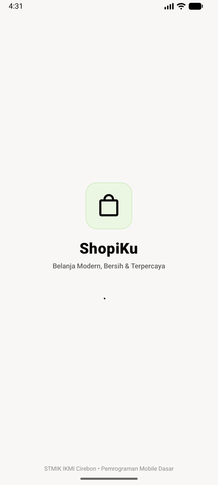 | 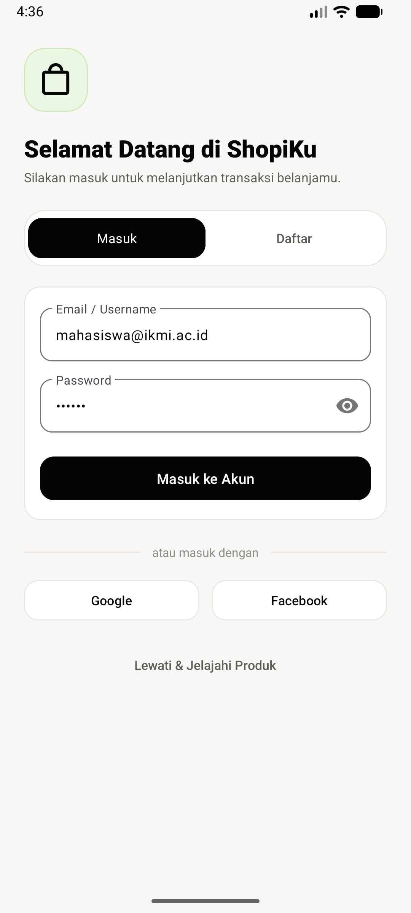 | 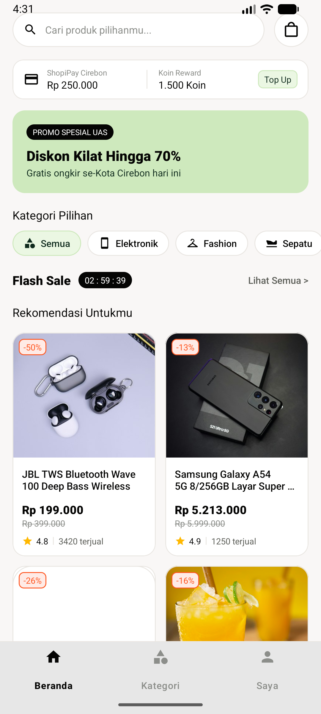 |
| *Branding visual & inisialisasi sesi* | *Tab Masuk / Registrasi & validasi* | *Dashboard, saldo wallet, & flash sale* |

### 2. Eksplorasi & Katalog Produk
| 4. Kategori Produk | 5. Daftar Produk & Pencarian | 6. Detail Produk |
|:---:|:---:|:---:|
| 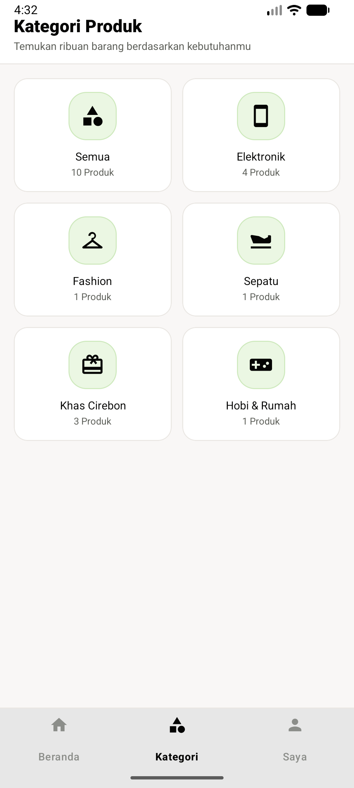 | 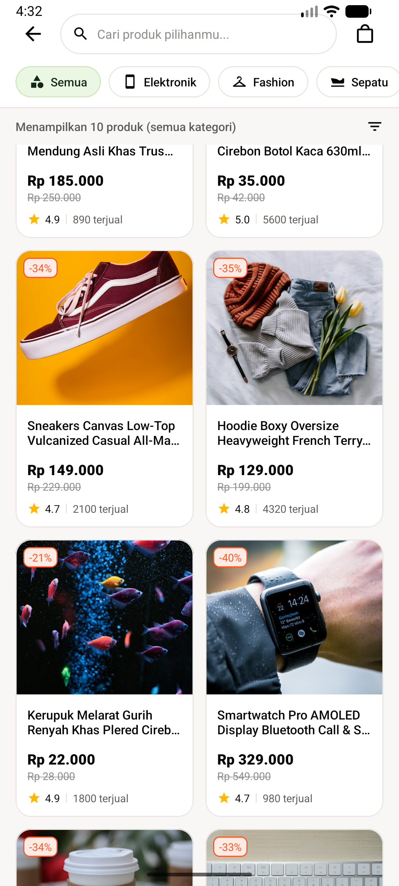 | 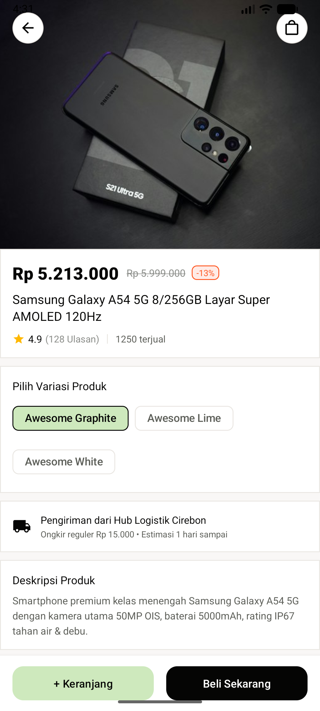 |
| *Grid kategori & counter jumlah produk* | *Katalog 2 kolom & live character search* | *Pilihan varian interaktif & rincian produk* |

### 3. Keranjang & Pembelian
| 7. Keranjang Belanja | 8. Checkout Pesanan | 9. Pembayaran Sandbox |
|:---:|:---:|:---:|
| 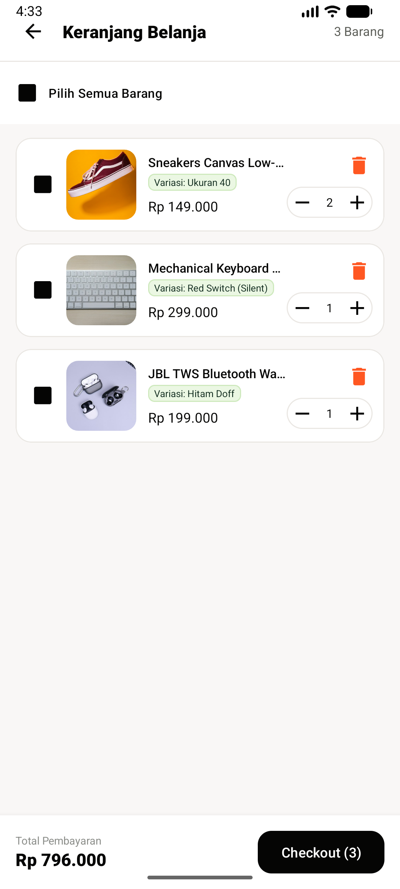 | 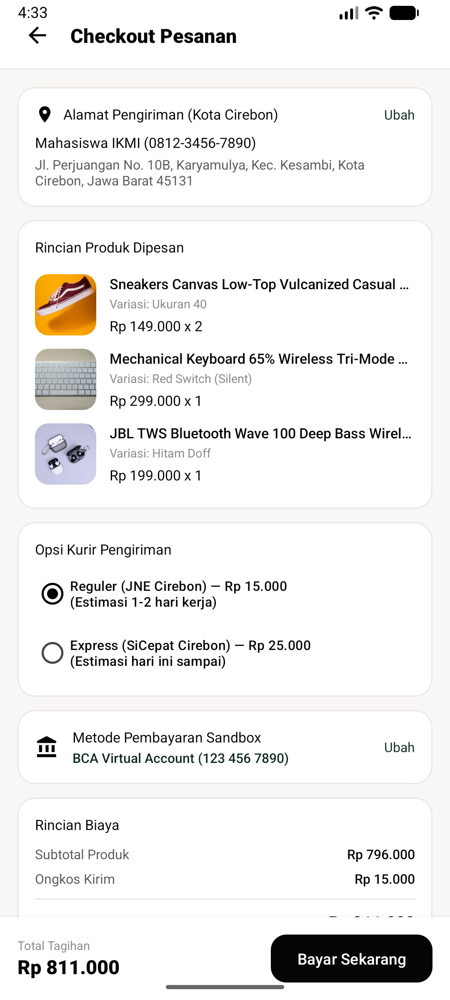 | 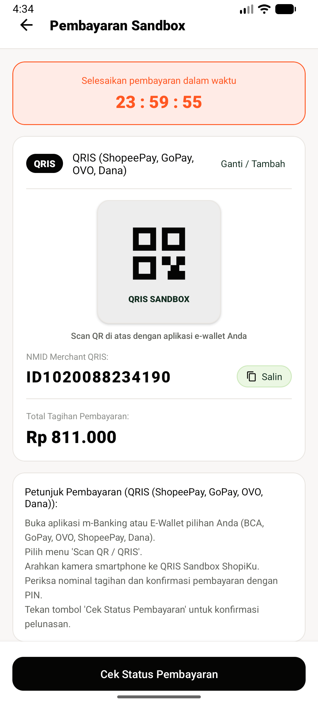 |
| *Full CRUD kuantitas & kalkulasi harga instan* | *Opsi kurir, alamat, & pemilihan metode bayar* | *Multi-channel payment & countdown timer* |

### 4. Pelacakan, Profil, & Ulasan
| 10. Tracking Pesanan | 11. Profil Akun | 12. Ulasan Produk |
|:---:|:---:|:---:|
| 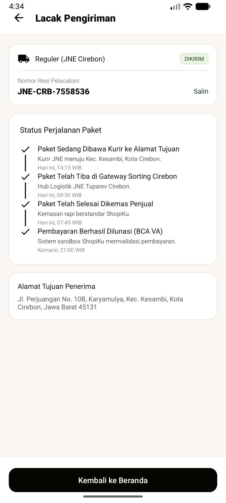 | 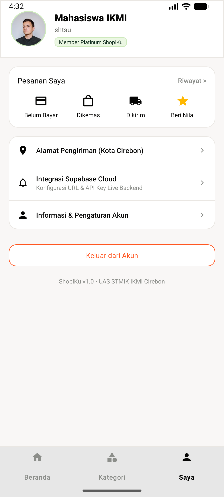 |  |
| *Visual stepper timeline pelacakan paket* | *Data akun & integrasi Supabase cloud* | *Rating agregat 5-bintang & testimoni ulasan* |

---

## 💳 Multi-Channel Sandbox Payment Gateway

The payment sandbox provides a full end-to-end simulation of modern payment methods without requiring real financial transactions:

```
[Checkout] ➔ [Select Method] ➔ [Generate Order & Code/VA] ➔ [Simulate Payment] ➔ [Order Tracking]
```

### Pre-Configured Payment Methods:
1. **BCA Virtual Account** (`VA: 123 456 7890`) — Instant 24-hour automated verification.
2. **Mandiri Virtual Account** (`VA: 8950 1234 5678`) — Multi-payment bank transfer via mobile banking.
3. **BRI Virtual Account (BRIVA)** (`VA: 1280 0123 4567`) — Direct transfer verification.
4. **BNI Virtual Account** (`VA: 9880 1234 5678`) — Virtual account billing channel.
5. **QRIS Universal QR** (`NMID: ID1020088234190`) — Interactive visual QR code frame for cross-wallet scanning.
6. **ShopeePay / SPayLater** (`Account: 0812-3456-7890`) — In-app e-wallet balance deduction.
7. **Indomaret / Alfamart** (`Pay Code: IKMI-SHOP-9912`) — Retail counter cash payment simulation.
8. **Cash on Delivery (COD)** — Cash payment settlement upon courier handover.

### Dynamic Custom Payment Channels:
Users and testers can dynamically add custom payment channels on the fly via the **"+ Tambah Metode Pembayaran Lain"** modal, specifying the provider name, account/VA number, badge tag, and category. Custom entries are instantly persisted into the active session.

---

## 🛠️ Tech Stack & Dependencies

* **Language**: [Kotlin](https://kotlinlang.org/) (Coroutines, Flow, LiveData)
* **Architecture**: Android Jetpack (ViewModel, LiveData, ViewBinding, Navigation)
* **Networking & Serialization**:
  * [Retrofit 2](https://square.github.io/retrofit/) — Type-safe HTTP client
  * [OkHttp 3](https://square.github.io/okhttp/) + Logging Interceptor — Robust HTTP connection pooling and request debugging
  * [Gson](https://github.com/google/gson) — Flexible JSON parsing and serialization
* **Image Loading & Caching**: [Glide](https://github.com/bumptech/glide)
* **UI Components**: Google Material Components 3 (M3), `ShapeableImageView`, `NestedScrollView`, `BottomSheetDialog`
* **Cloud Storage & Database**: [Supabase](https://supabase.com/) (PostgreSQL 15 + PostgREST)

---

## 📂 Project Structure

```
app/src/main/
├── java/com/project/myshopeegw/
│   ├── data/
│   │   ├── api/             # RetrofitClient, ShopeeApiService, MockDataProvider, PaymentMethodProvider
│   │   ├── model/           # Data models (Product, CartItem, Order, PaymentMethod, Category)
│   │   └── repository/      # Repository implementations (ProductRepository, CartRepository, OrderRepository)
│   ├── ui/
│   │   ├── adapter/         # RecyclerView Adapters (Product, Cart, Checkout, Category, PaymentMethod)
│   │   ├── auth/            # AuthActivity (Login / Register)
│   │   ├── cart/            # CartActivity (CRUD Shopping Cart)
│   │   ├── checkout/        # CheckoutActivity & PaymentSandboxActivity
│   │   ├── home/            # HomeFragment & CategoryFragment
│   │   ├── product/         # ProductListActivity & ProductDetailActivity
│   │   ├── profile/         # ProfileFragment & ReviewListActivity
│   │   └── tracking/        # OrderTrackingActivity
│   ├── utils/               # CurrencyHelper, PrefManager, Resource wrapper
│   ├── viewmodel/           # ProductViewModel, CartViewModel, CheckoutViewModel
│   └── MainActivity.kt      # Main container with Material 3 BottomNavigationView
└── res/
    ├── drawable/            # Custom vectors, state list selectors, background shapes
    ├── layout/              # XML layouts adhering to Material 3 design guidelines
    ├── values/              # colors.xml (Neo-Minimalist palette), themes.xml, dimens.xml
    └── menu/                # Bottom navigation and toolbar menus
```

---

## ⚡ Getting Started & Setup

### 📲 Direct APK Download (Siap Pakai)
Bagi pengguna atau penguji yang ingin langsung mencoba aplikasi tanpa perlu meng-compile dari source code:
* 📥 **[Download ShopiKu-v1.0.0.apk](https://github.com/Reefaai/MyShopeeGw/releases/download/v1.0.0/ShopiKu-v1.0.0.apk)** (~7.0 MB)
* 🏷️ **[Halaman Rilis Resmi GitHub (v1.0.0)](https://github.com/Reefaai/MyShopeeGw/releases/tag/v1.0.0)**

### Prerequisites
* Android Studio Iguana / Jellyfish / Ladybug or newer
* JDK 17 or JDK 21 (bundled JBR recommended)
* Android SDK Platform 34 (Minimum SDK: 24, Target SDK: 34)

### Clone & Build dari Source Code
```bash
# Clone the repository
git clone https://github.com/Reefaai/MyShopeeGw.git
cd MyShopeeGw

# Build Debug APK using Gradle
./gradlew assembleDebug
```

The compiled APK will be available at:
```
app/build/outputs/apk/debug/app-debug.apk
```

---

## 🌐 Supabase Cloud Database Configuration

ShopiKu is configured to connect with Supabase out of the box, with full support for custom project instances:

1. Create a new project at [supabase.com](https://supabase.com).
2. Navigate to **SQL Editor** in your Supabase dashboard.
3. Open and copy the contents of [`supabase_schema.sql`](file:///home/shtsu/AndroidStudioProjects/MyShopeeGw/supabase_schema.sql) located in the project root.
4. Paste and execute the SQL query to create the `products`, `cart`, and `orders` tables along with sample seed catalog data.
5. In your Supabase dashboard, navigate to **Project Settings > API** to obtain your `Project URL` and `anon public key`.
6. You can configure these credentials directly within the app under **Akun Saya > Integrasi Supabase Cloud**.

---

## 📄 License

This project is licensed under the [MIT License](LICENSE).
